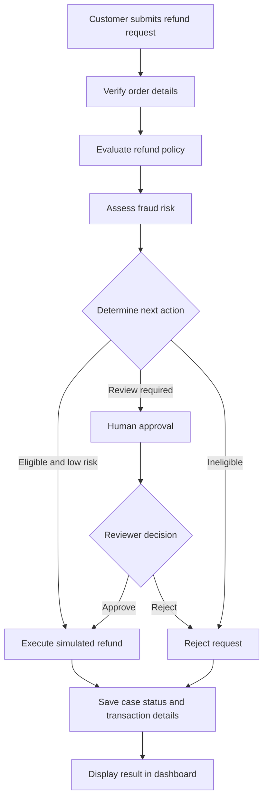

# ResolveAI — Intelligent Refund Resolution Workflow

ResolveAI is a workflow-based refund resolution application built using **Python, LangGraph, and Streamlit**. It automates the refund decision process through order verification, policy evaluation, fraud-risk assessment, and simulated refund execution.

The system uses conditional workflow routing and **human-in-the-loop review** to handle cases that require additional authorization. A Streamlit dashboard allows users to submit refund requests, inspect decisions, review pending cases, and track workflow execution.

## Features

- **Order Verification:** Retrieves order details from mock order data.
- **Refund Policy Evaluation:** Evaluates refund requests using predefined eligibility rules.
- **Fraud Risk Assessment:** Assigns risk levels to customers and routes sensitive cases for review.
- **Conditional Workflow Routing:** Uses LangGraph nodes to determine the next workflow step.
- **Human-in-the-Loop Review:** Allows reviewers to approve or reject pending requests.
- **Simulated Refund Execution:** Generates mock transaction IDs for processed refunds.
- **Persistent Workflow State:** Uses SQLite-backed checkpointing to preserve workflow progress.
- **Interactive Dashboard:** Displays refund decisions, case statuses, amounts, transaction IDs, and execution logs.
- **Reasoning and Execution Logs:** Shows workflow steps and tool outputs for debugging and transparency.
- **Automated Tests:** Includes tests for workflow logic and UI behavior.

## Tech Stack

| Technology | Purpose |
|---|---|
| Python | Core application logic |
| LangGraph | Stateful workflow orchestration |
| Streamlit | Interactive web dashboard |
| SQLite | Workflow checkpointing and persistence |
| Pydantic | Data validation and structured state |
| Pytest | Automated testing |

## Application Screenshots

### 1. Automatic Refund Processing

Shows a case that completes the workflow without human approval.


### 2. Human-in-the-Loop Approval

Shows a pending case with reviewer approval and rejection controls.


### 3. Rejected Refund

Shows a request rejected by the policy rules or a reviewer.


### 4. Decision Details and Risk Assessment

Shows order verification, policy verdict, fraud risk, and final decision.


### 5. Agent Execution Log

Shows workflow steps, tool calls, and recorded outputs.


### 6. Recent Cases Dashboard

Shows multiple refund cases and their statuses, amounts, and transaction details.


> Save your actual screenshots in the `screenshots/` folder using the filenames shown above. Remove any screenshot sections for which you do not have an image.

## System Workflow



The actual execution path depends on the configured policy rules, risk assessment, and workflow routing logic.

## Project Structure

```text
ResolveAI/
├── app.py
├── resolveai/
│   ├── __init__.py
│   ├── agent_graph.py
│   ├── state.py
│   ├── tools.py
│   └── registry.py
├── data/
│   └── resolveai.db
├── screenshots/
│   ├── automatic-refund.png
│   ├── human-approval.png
│   ├── rejected-refund.png
│   ├── decision-details.png
│   ├── agent-execution-log.png
│   └── recent-cases.png
├── test_flow.py
├── test_ui.py
├── requirements.txt
├── .gitignore
└── README.md
```

## Getting Started

### Prerequisites

- Python 3.11 or a compatible Python version
- pip
- Git

### 1. Clone the Repository

```bash
git clone <YOUR_GITHUB_REPOSITORY_URL>
cd ResolveAI
```

Replace the placeholder with your actual repository URL.

### 2. Create a Virtual Environment

**Windows PowerShell:**

```powershell
python -m venv .venv
.venv\Scripts\Activate.ps1
```

### 3. Install Dependencies

```bash
python -m pip install -r requirements.txt
```

### 4. Launch the Application

```bash
python -m streamlit run app.py
```

Open the local URL displayed in your terminal, usually:

`http://localhost:8501`

## Running Tests

Run the test suite from the project root:

```bash
python -m pytest -v
```

The tests cover workflow behavior and UI functionality. Run them in your environment to verify the current implementation.

## Test Scenarios

ResolveAI includes six mock order scenarios for testing different decision paths.

| Order ID | Customer ID | Scenario | Expected behavior |
|---|---|---|---|
| ORD-1001 | CUST-001 | Damaged wireless headphones | Automatic refund, subject to policy and routing |
| ORD-1002 | CUST-002 | Cracked monitor | Human review for high-value refund |
| ORD-1003 | CUST-001 | Damaged keyboard | Human review for a borderline policy verdict |
| ORD-1004 | CUST-666 | Damaged smartwatch | Human review for high fraud risk |
| ORD-1005 | CUST-002 | USB hub return after changing mind | Human review for a borderline policy verdict |
| ORD-1006 | CUST-001 | Desk lamp return after changing mind | Rejection for an ineligible request |

These are the intended test scenarios based on the configured mock data and routing rules. Actual results depend on the current implementation.

## Design and Safety Considerations

- **Human oversight:** Requests that meet configured review conditions can be paused for a reviewer decision.
- **Controlled execution:** Refund processing is simulated using mock tools.
- **State persistence:** SQLite checkpointing supports stateful workflow execution.
- **Policy-driven decisions:** Eligibility and risk routing are based on predefined rules.
- **Transparency:** Workflow logs help reviewers inspect the sequence of execution.

## Limitations

- Uses mock customer and order data.
- Does not transfer real money or connect to a payment gateway.
- Fraud scoring and policy evaluation use predefined rules.
- The current version is rule-based and does not yet use an LLM for reasoning or dynamic tool selection.
- It is a demonstration project, not a production-ready financial system.

## Future Enhancements

- Integrate an LLM for structured reasoning and request classification.
- Add controlled LLM tool calling.
- Introduce authentication and role-based reviewer permissions.
- Add a dedicated audit trail and improved monitoring.
- Integrate secure test-environment APIs for order and payment services.
- Improve policy configuration and error recovery.

## Author

**Sanika Deokar**

A project exploring stateful workflow orchestration, refund automation, and human-in-the-loop systems using Python and LangGraph.
